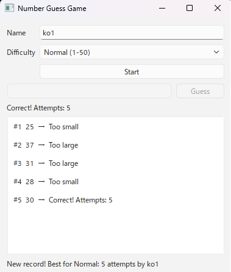
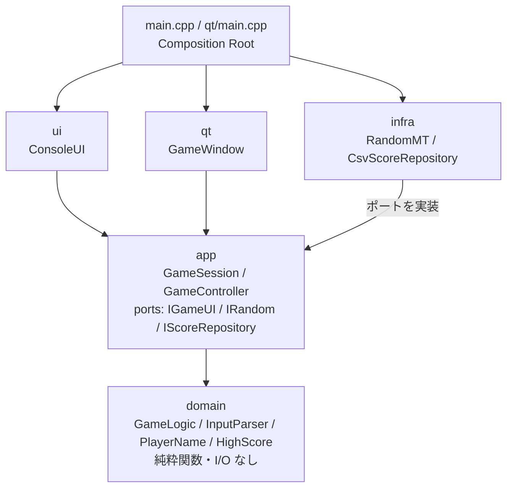

# Number Guess Game（C++）

[](https://github.com/KoichiKurita/CPPlang-Number-Guess-Game/actions/workflows/ci.yml)
[](https://scorecard.dev/viewer/?uri=github.com/KoichiKurita/CPPlang-Number-Guess-Game)


[](https://codecov.io/gh/KoichiKurita/CPPlang-Number-Guess-Game)
[](LICENSE)

1〜N の数を当てる、シンプルな数当てゲームです。
ゲーム自体は小さく保ち、**設計・テスト容易性・品質保証（CI / 静的・動的解析）・セキュリティ**を実践するための C++ ポートフォリオとして作っています。



## 特徴

| 観点 | 内容 |
|---|---|
| 設計 | レイヤードアーキテクチャ＋ポート&アダプタ。ゲームのルールは I/O を持たない純粋関数 |
| UI | 同じロジックを **Console 版** と **Qt 6 版（GUI）** で共有 |
| テスト | GoogleTest / Qt Test で **77 件**（純粋関数・テストダブル・実ファイル・画面操作・アーキテクチャテスト）。カバレッジを Codecov で計測 |
| CI | Windows（MinGW / MSVC）・Linux（GCC / Clang）の **7 ジョブ**。Linux では AddressSanitizer / UBSan |
| 品質 | 警告をエラー扱い（`-Wall -Wextra -Wpedantic -Wconversion` ほか、MSVC は `/W4 /permissive-`）、clang-tidy による静的解析、clang-format による書式の統一 |
| セキュリティ | 入力の許可リスト検証、CSV インジェクション対策（多層防御）、CI の最小権限 |
| 信頼性 | 不正入力・EOF でも停止しない、保存失敗でゲームを落とさない、壊れたファイルを読み飛ばす |

## 遊び方

1. 名前を入力します（英数字・スペース・`_`・`-`、先頭は英数字、16 文字まで）。
2. 難易度を選びます：Easy（1〜10）/ Normal（1〜50）/ Hard（1〜100）。
3. 数を予想すると「Too small / Too large」のヒントが出ます。正解するまで続けます。
4. 正解すると、難易度ごとの最高記録（最少回数）が表示されます。

スコアは次の場所に CSV で保存されます（環境変数 `NGG_SCORE_FILE` で変更できます）。

| OS | 保存先 |
|---|---|
| Windows | `%APPDATA%\NumberGuessGame\scores.csv` |
| Linux / macOS | `$XDG_DATA_HOME/NumberGuessGame/scores.csv`（未設定なら `~/.local/share/...`） |

## ダウンロード（Windows）

[Releases](https://github.com/KoichiKurita/CPPlang-Number-Guess-Game/releases/latest) から `NumberGuessGame-v<バージョン>-windows-x64.zip` をダウンロードし、展開したフォルダの `NumberGuessGameQt.exe`（GUI 版）または `NumberGuessGame.exe`（Console 版）を起動します。インストールは不要です。

### 配布物の検証

配布物は GitHub Actions だけで作られ、改ざんされていないことを次の 2 つの方法で確かめられます。

```powershell
# 1. チェックサム（.zip.sha256 に書かれた値と一致すること）
Get-FileHash .\NumberGuessGame-v<バージョン>-windows-x64.zip -Algorithm SHA256

# 2. 来歴証明（このリポジトリの CI で、どのコミットから作られたかを Sigstore の署名で確認する）
gh attestation verify .\NumberGuessGame-v<バージョン>-windows-x64.zip --repo KoichiKurita/CPPlang-Number-Guess-Game
```

来歴証明の一覧は、リポジトリの [Attestations](https://github.com/KoichiKurita/CPPlang-Number-Guess-Game/attestations) でも確認できます。

### SBOM（ソフトウェア部品表）

各リリースには、配布物に含まれる部品（Qt・ICU・コンパイラのランタイムなど、MSYS2 から同梱したライブラリ）の名前・バージョン・ライセンスを、標準形式（SPDX 2.3）で記した `NumberGuessGame-v<バージョン>-windows-x64.spdx.json` を添付しています。
SBOM と配布物の対応も署名付きで記録しているので、次のコマンドで検証できます。

```powershell
gh attestation verify .\NumberGuessGame-v<バージョン>-windows-x64.zip --repo KoichiKurita/CPPlang-Number-Guess-Game --predicate-type https://spdx.dev/Document/v2.3
```

脆弱性が公表されたときは、この SBOM を見れば、影響を受けるライブラリが配布物に含まれているかをすぐに確認できます。

## ビルドと実行

### 必要なもの
- C++17 コンパイラ（GCC / Clang / MSVC）
- CMake 3.21 以上、Ninja
- Qt 6（Qt 版をビルドする場合のみ）

GoogleTest は CMake（FetchContent）が自動で取得します。

### Windows（MSYS2 MINGW64）
```bash
pacman -S --needed mingw-w64-x86_64-gcc mingw-w64-x86_64-cmake \
                   mingw-w64-x86_64-ninja mingw-w64-x86_64-qt6-base

cmake --preset qt            # Console 版 + Qt 版 + テスト
cmake --build --preset qt
ctest --preset qt

./build/qt/src/NumberGuessGame.exe      # Console 版
./build/qt/qt/NumberGuessGameQt.exe     # Qt 版
```

### Linux（Ubuntu 24.04）
```bash
sudo apt-get install -y g++ cmake ninja-build qt6-base-dev

cmake --preset qt && cmake --build --preset qt && ctest --preset qt
```

### CMake プリセット

| プリセット | 内容 |
|---|---|
| `dev` | ローカル開発用（警告は表示のみ） |
| `ci` | 警告をエラー扱い（Console 版とテスト） |
| `qt` | `ci` ＋ Qt 版 GUI と画面テスト |
| `asan` | `ci` ＋ AddressSanitizer / UBSan（Linux / macOS の GCC・Clang） |
| `tidy` | `qt` ＋ clang-tidy（コンパイルと同時に静的解析） |
| `coverage` | `qt` ＋ カバレッジ計測（gcov。GCC・Clang） |
| `release` | 配布用の Release ビルド（Qt 版を含む） |
| `msvc` | Visual Studio（Windows） |

### 書式と静的解析

書式は `.clang-format`、静的解析のルールは `.clang-tidy` で定義しています（LLVM 23 系で確認）。

```bash
# Windows（MSYS2 MINGW64）での準備
pacman -S --needed mingw-w64-x86_64-clang mingw-w64-x86_64-clang-tools-extra

# 書式を整える / 確認する
git ls-files '*.cpp' '*.h' | xargs clang-format -i
git ls-files '*.cpp' '*.h' | xargs clang-format --dry-run --Werror

# 静的解析（コンパイルと同時に clang-tidy を実行する）
cmake --preset tidy && cmake --build --preset tidy
```

## アーキテクチャ



- **domain**：ゲームのルールと入力検証。I/O もフレームワークも持たない純粋関数なので、そのままテストできます。
- **app**：ゲームを「1 手ずつ」進める `GameSession` と、外部に求める機能のインターフェース（**ポート**）。具体的な実装は知りません（依存性逆転の原則）。
- **ui / qt / infra**：ポートの実装（**アダプタ**）。Console と Qt は、同じ `GameSession` を、ループから呼ぶか、イベントから呼ぶかだけが違います。

依存の向きは、CMake のターゲット（`PUBLIC` / `PRIVATE`）と、`ctest` で実行する**アーキテクチャテスト**（`cmake/CheckLayerDependencies.cmake`）で守っています。

設計の詳細（シーケンス図・ドメインモデル・エラー処理の方針・設計判断）は [docs/design.md](docs/design.md) にまとめています。

## 品質保証

### テスト（77 件）

| 対象 | テスト | 手法 |
|---|---|---|
| domain | `GameLogicTest` / `InputParserTest` / `PlayerNameTest` / `HighScoreTest` | 純粋関数の入出力・境界値 |
| app | `GameSessionTest` / `GameControllerTest` | Mock / Fake の注入、失敗の再現 |
| infra | `RandomMTTest` / `CsvTest` / `CsvScoreRepositoryTest` | シード固定、ラウンドトリップ、一時フォルダの実ファイル |
| ui | `ConsoleUITest` | `std::istringstream` / `std::ostringstream` の注入 |
| qt | `GameWindowTest`（Qt Test） | 文字入力・クリック・Enter による画面操作（CI では offscreen） |
| 構成 | `LayerDependencies` | レイヤー間の依存ルール違反と相対インクルードを検出 |

### カバレッジ

テストでどの行が実行されたかを gcov で計測し、lcov でレポートにしています。結果は [Codecov](https://codecov.io/gh/KoichiKurita/CPPlang-Number-Guess-Game) で確認でき、PR ごとに増減がコメントされます。
テストから一度も実行されないファイル（`main.cpp` など）も 0% として数えています。

```bash
cmake --preset coverage && cmake --build --preset coverage && ctest --preset coverage
./scripts/coverage.sh build/coverage coverage   # coverage/html/index.html をブラウザで開く
```

### CI（GitHub Actions）

| ジョブ | 環境 | 目的 |
|---|---|---|
| Windows (MinGW GCC) | MSYS2 + Qt 6 | 開発環境と同じ構成。Qt 版を含む |
| Windows (MSVC) | Visual Studio | MSVC 固有の警告・規格準拠 |
| Linux (GCC, ASan + UBSan) | Ubuntu 24.04 | メモリ破壊・未定義動作の実行時検出 |
| Linux (Clang, ASan + UBSan) | Ubuntu 24.04 | 別コンパイラでの警告とサニタイザ |
| Linux (GCC, Qt GUI) | Ubuntu 24.04 + Qt 6 | Qt 版の別環境でのビルドと画面テスト |
| Lint (clang-format, clang-tidy) | Ubuntu 24.04 + LLVM 23 | 書式の確認と静的解析（指摘があれば失敗） |
| Coverage (gcov, lcov) | Ubuntu 24.04 + Qt 6 | カバレッジを計測し、Codecov に送る（HTML レポートは Artifacts） |

- テストが 0 件なら失敗にする（`noTestsAction: error`）
- 外部の Action はすべてコミットハッシュで固定し、実行環境のイメージもバージョンを固定する（固定漏れは Lint ジョブで検出）
- 依存関係の更新：GitHub Actions と Lint のツール（clang-format / clang-tidy）は Dependabot が毎週提案する。Dependabot の対象外の googletest は、`check-googletest` ワークフローが毎週新しいリリースを確認し、Issue で知らせる
- OpenSSF Scorecard で、リポジトリのセキュリティ対策を毎週採点する（結果は Security タブと README のバッジで確認できる）
- ワークフローの権限は `contents: read` のみ（最小権限）。リリースでは、署名（来歴証明）と公開のジョブにだけ、それぞれ必要な書き込み権限を与える
- `main` / `develop` はルールセットで保護（PR 必須・全ジョブ成功必須・強制 push 禁止）

## セキュリティと信頼性

| 脅威・障害 | 対策 |
|---|---|
| 数字以外・範囲外・EOF の入力 | 1 行単位で読み、`std::from_chars` で厳密に変換。再入力させる。EOF は例外で `main` まで伝えて正常終了 |
| 極端に長い入力 | 1 行 256 文字（Qt 版は入力欄の最大長）を超える入力は受け付けない |
| CSV インジェクション（表計算ソフトでの数式実行） | ① 名前を許可リストで検証し先頭を英数字に限定 ② 書き出し時に `= + - @` で始まる値の先頭に `'` を付ける ③ 読み込み時に再検証 |
| スコアファイルの改ざん・破損 | 壊れた行だけを読み飛ばして続行 |
| 保存先に書き込めない・ディスクフル | `flush` 後のストリーム状態で検出し、警告を表示。ゲームは異常終了させない |
| 未定義動作・メモリ破壊 | サニタイザ付きのテストを CI で常時実行 |
| 配布物に含まれる部品の把握 | リリースごとに SBOM（SPDX 2.3）を作って形式を検証し、配布物との対応を署名付きで記録する。脆弱性が公表されたときに、影響の有無をすぐに確認できる |
| 依存関係の古さ・脆弱性 | Dependabot と googletest の確認ワークフローで更新を検知する。公開から 7 日たったバージョンだけを取り込み（クールダウン）、乗っ取られた直後のバージョンを避ける |
| CI で使う外部 Action の改ざん | タグ（`@v4` など）ではなくコミットハッシュで固定し、書き換えられた Action が実行されないようにする |
| 配布物の改ざん・なりすまし | SHA-256 チェックサムと、Sigstore で署名した来歴証明（SLSA build provenance）を付け、公開前に CI で検証する |
| セキュリティ対策の抜け漏れ | OpenSSF Scorecard で、外部の基準（依存関係の固定・最小権限・ブランチの保護など）に沿って毎週採点し、点数の低い項目を見直す |
| 脆弱性の報告が公開されてしまう | [SECURITY.md](SECURITY.md) で報告の窓口（GitHub の非公開の脆弱性報告）と対応の流れを定め、修正前に悪用されることを防ぐ |

## ディレクトリ構成

```
.
├── src/
│   ├── domain/   ゲームのルール・入力検証（ヘッダのみ・純粋関数）
│   ├── app/      GameSession / GameController / ports（インターフェース）
│   ├── infra/    乱数・CSV の保存・保存先の決定
│   ├── ui/       Console 版 UI
│   └── main.cpp  Console 版の Composition Root
├── qt/           Qt 版 GUI（GameWindow / main.cpp / tests）
├── tests/        GoogleTest のテストとテストダブル
├── cmake/        警告設定・サニタイザ・アーキテクチャテスト
├── docs/         設計ドキュメント
├── CMakePresets.json
└── .github/workflows/ci.yml
```

## 設計の変遷

このプロジェクトは、段階的に設計を見直しながら育ててきました。

1. **クラスベースの State パターン**：状態を仮想関数で表現。状態遷移の追跡が難しく、結合が強かった。
2. **`std::variant` による状態機械**：状態を値として扱い、仮想関数をなくした。
3. **純粋関数のドメイン**：`guess(state, value)` が「次の状態」と「イベント」を返す形にし、I/O から完全に分離した。
4. **品質改善（v1.1.0）**：入力検証による無限ループの修正、テストの復活と拡充、ポートの app 層への移動、CI の多環境化とサニタイザ、スコア保存の信頼性・安全性の向上。
5. **GUI 対応（v2.0.0）**：同期ループを「1 手ずつ」進める `GameSession` に分離し、Console 版と Qt 版でロジックを共有。

各段階の変更内容は、[Releases](https://github.com/KoichiKurita/CPPlang-Number-Guess-Game/releases) と Pull Request で確認できます。

## ライセンス

このプロジェクトのソースコードは [MIT License](LICENSE) で公開しています。

Windows 向けの配布パッケージには、[Qt 6](https://www.qt.io/)（LGPL v3）と、Qt が依存するライブラリの DLL を変更せずに同梱しています。
各ライブラリのライセンス文書は、配布 zip の `licenses` フォルダに含まれています。

## 開発について

設計の検討・コードの提案・デバッグの補助に、生成 AI（ChatGPT、Claude）を利用しています。
コードの転記・ビルド・デバッグ・動作確認・Issue / PR の管理、および最終的な判断は作者自身が行っています。
