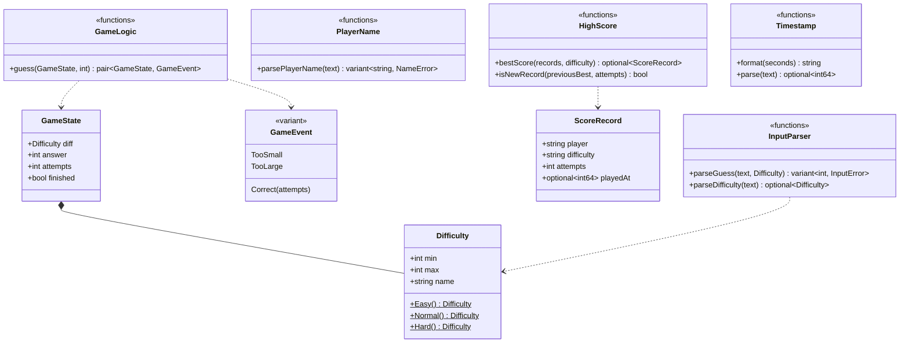
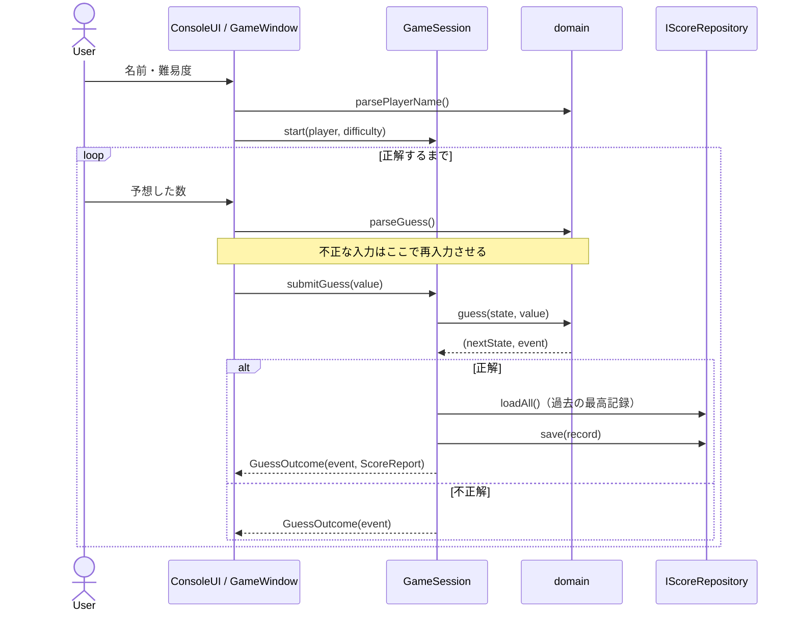

# 設計ドキュメント

[README](../README.md) の補足として、設計の詳細と判断の理由をまとめます。

## 1. レイヤーと依存ルール

| レイヤー | 役割 | 依存してよい | 禁止 |
|---|---|---|---|
| domain | ゲームのルール・入力検証（純粋関数） | なし | app / infra / ui |
| app | ゲーム進行、ポート（インターフェース）の定義 | domain | infra / ui |
| infra | ポートの実装（乱数・永続化） | app, domain | ui |
| ui | ポートの実装（Console） | app, domain | infra |
| qt | Qt 版の画面 | app, domain | — |

- インクルードは `src/` 起点で書き、相対パス（`../`）は使いません。
- 具体クラスを組み立てるのは `src/main.cpp` と `qt/main.cpp`（Composition Root）だけです。
- ルール違反は `ctest` の `LayerDependencies`（`cmake/CheckLayerDependencies.cmake`）が検出します。

## 2. ドメインモデル

- 状態（`GameState`）は値として扱い、`guess` は**引数を変更せずに**「次の状態」と「イベント」を返します。
- イベントは `std::variant` で表し、UI 側は `std::visit` と `if constexpr` ですべての種類を処理します。

## 3. 1 ゲームの流れ

Console 版は `GameController` がこの流れをループで回し、Qt 版は `GameWindow` がボタンや Enter キーのイベントごとに `submitGuess` を 1 回呼びます。

## 4. エラー処理の方針

失敗の種類によって、表し方と扱う場所を分けています。

| 失敗 | 表し方 | 扱う場所 | 振る舞い |
|---|---|---|---|
| 入力の誤り（数字以外・範囲外・名前が不正） | 戻り値（`std::variant<T, Error>`） | UI | メッセージを表示して再入力させる |
| 入力の終了（EOF） | 例外 `InputClosedError` | `main` | 正常終了（終了コード 0） |
| 保存・読み込みの失敗 | 例外 `ScoreRepositoryError` | `GameSession` | 警告として UI に返す。ゲームは続行 |
| ファイルの壊れた行 | 読み飛ばす | `CsvScoreRepository` | 正しい行だけを使う |
| API の誤用（開始前の予想など） | 例外 `std::logic_error` | — | プログラムの誤りなので、テストで検出する |
| 想定外の例外 | 例外 | `main` | メッセージを表示して終了コード 1 |

- **想定内で、呼び出し元が必ず処理すべき失敗**は戻り値で表し、処理し忘れを型で防ぎます。
- **その場では回復できない失敗**は例外で上位に伝え、扱う場所を 1 か所に絞ります。

## 5. 主な設計判断

### ポートを app 層に置く
`IRandom` / `IScoreRepository` / `IGameUI` / `IClock` は、それを**使う側**の app 層が定義し、infra と ui が実装します。app は具体的な実装を知らないので、テストでは Mock / Fake に差し替えられます（依存性逆転の原則）。乱数や現在時刻のように、実行のたびに変わるものもポートの向こうに置くことで、テストの結果を毎回同じにしています。

### ゲーム進行を「1 手ずつ」の API にする
当初の `GameController::run()` は「入力を待って返る」同期ループで、GUI のイベントループと両立しませんでした。そこで `GameSession`（`start` / `submitGuess`）に分離し、入力の待ち方を呼び出し側に任せました。分離の前後で `GameControllerTest` は変更せずにすべて成功しており、外から見た振る舞いを変えていないことを確認しています。

### 入力検証を domain の純粋関数にする
`parseGuess` / `parsePlayerName` は I/O を持たないので、境界値や攻撃的な入力を簡単にテストできます。Console 版と Qt 版の両方が同じ関数を使うので、検証ルールがずれることもありません。

### スコアの保存形式に CSV を使う
人が読めて、表計算ソフトでも開けることを優先しました。その代わり、区切り文字の混入と CSV インジェクションへの対策（エスケープ・許可リスト・読み込み時の再検証）を必須にしています。

### テストダブルの使い分け

| 名前 | 種類 | 役割 |
|---|---|---|
| `MockRandom` | Stub / Spy | 固定値を返し、受け取った範囲を記録する |
| `MockUI` | Mock | 決められた入力を返し、受け取ったイベントや表示内容を記録する |
| `FakeScoreRepository` | Fake | メモリ上で実際に保存・読み込みを行い、失敗も再現できる |
